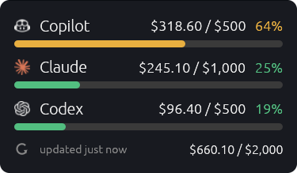
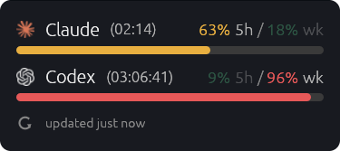

# usage-widget

A small always-on-top Windows widget that shows how much of your GitHub Copilot,
Claude and Codex allowance you have used.

| Business plans | Personal subscriptions |
| --- | --- |
|  |  |

Minimized:


## Install

Download `usage-widget.exe` from the
[latest release](https://github.com/pepsi-enjoyer/usage-widget/releases/latest), put it
somewhere permanent and run it. To start it at login, run `usage-widget --startup`
once (`--no-startup` undoes it).

Or build it with [Rust](https://rustup.rs):

```
cargo install --git https://github.com/pepsi-enjoyer/usage-widget
```

It updates itself from new releases.

## Setup

There is nothing to log in to. The widget uses the logins your CLIs already have:

- **Copilot:** the GitHub CLI (`gh auth login`)
- **Claude:** Claude Code (`claude`)
- **Codex:** the Codex CLI (`codex`)

Only services you have a paid plan with are shown. If a token expires, the widget
says so; run that CLI once and it picks the new token up. Right-click > Refresh
token does that for Claude or Codex: it runs a one-line prompt on the cheapest
model, which uses a little of your allowance, then refreshes.

## What it shows

- **Business plans** (Copilot Business/Enterprise, Claude Team/Enterprise, ChatGPT
  Business/Enterprise): dollars spent against your limit, with a total at the bottom.
- **Personal plans** (Claude Pro/Max, ChatGPT Plus/Pro): your 5-hour and weekly usage.
  The one you will run out of first is highlighted, the bar shows it, and the timer
  shows when it resets. Copilot Pro shows its monthly allowance.

Bars go green, yellow and red as you use more.

## Using it

- Drag it anywhere. It remembers where it was.
- Right-click to refresh, refresh a service's token, minimize, resize, check for
  updates, open each service's usage page, or quit.
- Untick a service under Show in the right-click menu to hide it. Tick it again to
  bring it back.
- Hover a red error to see the full message.
- Hover a personal plan's countdown, or a window's percentage or label, to see when
  that window resets.
- `usage-widget usage` prints the same numbers as JSON without opening a window.
  The [usage-widget skill](skills/usage-widget/SKILL.md) lets agents read it.

Optional settings, as environment variables:

| Variable | Does | Default |
| --- | --- | --- |
| `USAGE_WIDGET_REFRESH_MINS` | Minutes between refreshes | `5` |
| `USAGE_WIDGET_OPACITY` | Window opacity, 20-100 | `85` |
| `USAGE_WIDGET_AUTO_UPDATE` | `0` turns off automatic updates | on |

## Notes

The usage numbers come from the same endpoints the CLIs and web settings pages use.
They are not officially documented and may change. Logos are from
[Simple Icons](https://simpleicons.org) (CC0); the marks belong to their owners.
